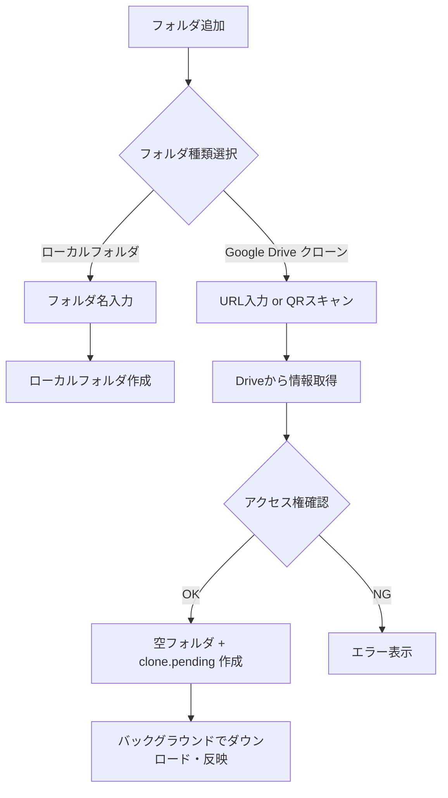

# Google Drive連携

## 概要

こかげマップのフォルダを Google Drive と同期し、複数デバイス間でのデータ共有やバックアップを実現する機能。Android と web の両方に対応する。

### 基本方針

- データは**ローカルファーストで保存・編集**（オフラインでもそのまま作業可能）
- **フォルダ単位**での連携（任意のサブフォルダごとに Drive フォルダや共有プリセットと紐付け可能）
- 同期は手動（アップロード / ダウンロード）および Wi-Fi 接続時の自動同期に対応
- 同じ `.gpkg` が端末と Drive の両方で編集された場合は **geodiff による行単位の 3-way マージ**（[[../technical/drive-geodiff-sync]]）に対応
- 共有は **QR コード / URL ベース**（共有リンクや QR コードを渡すだけで複数ユーザーが受け取れる）

---

## フォルダ単位連携

### Drive連携フォルダの追加フロー



### UIの特徴

- **アイコンと状態表示**: Drive 連携フォルダはクラウドアイコンと同期状態（同期済み / ローカル変更あり / Drive に変更あり / 競合 / 読み取り専用）を表示
- **進捗バー**: バックグラウンド転送中はフォルダ行とタイトルバー、通知ベルに進捗バーを表示

### QRコード共有

Drive連携フォルダの長押しメニュー →「QRコードで渡す」で QR を出す（2026-10-03〜）。中身は
`https://kokage-map.sleeptree.jp/open?drive=<Drive フォルダ ID>`。

1. 受け取る側がスマホのカメラで読む。アプリが入っていれば App Links でアプリが開く
   （`web/.well-known/assetlinks.json` で検証。Play 署名・アップロード鍵・開発用の debug 鍵）
2. ホームが Google の無音復元 → だめならサインイン → フォルダ情報（`lookupFolder`）を確認 → いつもの地図の `共有/<フォルダ名>` と `.sync/clone.pending` を即座に用意して先に地図を開き、実データのダウンロードはバックグラウンドで進める。
   同じ Drive フォルダが取り込み済みなら開くだけ（未完了マーカー `.sync/clone.pending` が残っていればバックグラウンドでダウンロードを再開）。ダウンロード完了時は通知が切り替わり「地図で見る」アクションで取り込んだ地図の範囲へ寄る
3. アプリが無いスマホ・PC では `/open/` のページがテスター募集ページ（`/beta/`）へ移る。**製品版では Play のページへ替える**
4. ホームの「QR で受け取る」（アプリのカメラ・URL 貼り付け）でも同じ。Drive の URL そのものも読める

実装: `lib/core/shared_link.dart`（リンクの形）・`lib/services/shared_map_link.dart`（取り込み）・
`MainActivity`（起動時は `initialLink` で渡す、起動中は `link`）。`flutter_deeplinking_enabled=false` で Navigator には渡さない。

> [!WARNING] オープンベータの前に
> `assetlinks.json` の debug 鍵を外し、`web/open/index.html` の行き先を Play に替える。

### JSON共有フォルダセット（プリセット・入れ子対応）

複数のDrive共有フォルダや下位プリセットJSONをまとめたマニフェスト（`.json`ファイル）のDrive共有リンク（またはQRコード）を読み込むことで、`共有/<セット名>/` 配下にツリー構造として一括展開・自動追従できる（`DriveFolderSetNode` / `DriveFolderSetService`）。

#### JSONフォーマット（単一統一形式・Compositeパターン）

どのJSONファイルも「単独のトップレベルプリセット」としても「親JSONから参照される子プリセット」としてもそのまま利用できる。`presets`（別名 `sets` / `children`）と `folders`（別名 `dirs` / `urls` / `items`）は分けて書いても、`folders` 配列にフォルダURLとJSONファイルURLを混在させてもよい（取得したDriveメタデータの `mimeType` / 拡張子 `.json` で自動判別）。

```json
{
  "name": "調査エリア_全体地図",
  "presets": [
    "https://drive.google.com/file/d/<子プリセットJSONのID>/view?usp=sharing",
    {
      "preset": "https://drive.google.com/file/d/<別の子プリセットJSONのID>/view?usp=sharing",
      "readOnly": true
    }
  ],
  "folders": [
    "https://drive.google.com/drive/folders/<DriveフォルダID>?usp=sharing",
    {
      "url": "https://drive.google.com/drive/folders/<読み取り専用フォルダID>",
      "readOnly": true
    }
  ]
}
```

#### 安全ガード（循環参照・重複・誤削除防止）

1. **ツリー横断 `visitedDriveIds` による循環参照・重複排除（先勝ち）**:
   ルートセットから展開されるツリー全体で一度登場した `driveId`（JSONファイルIDおよびフォルダID）を記録し、自己参照・相互参照ループ（`A.json → B.json → A.json`）やダイヤモンド参照による同一フォルダの二重クローンを防止する。
2. **深さ上限・総数上限ガード**:
   最大ネスト深さ `kMaxSetDepth = 5`、1ツリーあたりの最大アイテム総数 `kMaxSetTotalItems = 100` を超える項目は自動スキップする。
3. **`readOnly` の単調継承**:
   親JSON側で子JSONエントリに `"readOnly": true` が指定された場合、子JSON内の各項目が `"readOnly": false` であっても配下の全フォルダ・孫セットに読み取り専用が強制継承される。
4. **子セット除外時の再帰的ローカル変更保護**:
   親JSONから子JSONが削除された際、子セット配下の全子孫 `DriveFolderNode` を再帰検査し、1つでも未送信のローカル変更がある場合は子セットの削除を保留して保護する。
5. **親MD5未変更時の子セット再帰チェック**:
   親JSON自体の `md5Checksum` が前回同期時から変わっていなくても、既存の子セット（`DriveFolderSetNode`）を辿って子JSON側の更新有無を確認する。

---

## 同期対象と状態管理

### 同期対象ファイル

`SyncEngine`（`lib/services/google_drive/sync_engine.dart`）がフォルダ配下の対象ファイルを再帰的に走査する：

- GeoPackage（`.gpkg`）
- フォルダ設定（`<Driveのフォルダ名>.qgs`）
- 写真・画像（`.jpg`, `.jpeg`, `.png`, `.webp`, `.tif`, `.tiff` 等）
- 外部ベクタ・表（`.shp` と付属ファイル一式、`.geojson`, `.json`, `.kml`, `.kmz`, `.csv`, `.gpx`, `.fgb`, `.gml`, `.dxf`, `.tab`, `.mif`, `.mid`, `.vrt` 等）

点で始まる隠しフォルダ（`.sync`, `.kokage` 等）や SQLite の一時ファイル（`-wal`, `-shm`, `-journal`）は同期対象から除外される。

### 同期帳簿（`SyncLedger`）と行単位マージ（geodiff）

- 前回同期時のファイル状態（MD5・サイズ・更新日時）は `SyncLedger`（SharedPreferences）に記録し、3-way 比較（ローカルのみ変更 / リモートのみ変更 / 両方変更）を行う。
- `.gpkg` のベースコピーは `<フォルダ>/.sync/base/` に保持し、ローカルと Drive の両方で同じ `.gpkg` が変更された場合は geodiff で行単位の 3-way マージを行う（[[../technical/drive-geodiff-sync]]）。
- `.qgs` の競合時は `QgsMerge` で両側の設定を統合する。

### 進捗表示とバックグラウンド転送

Drive連携フォルダの追加（クローン）・QR共有受取・マージ同期では、`SyncProgress` による3フェーズのバイト加重進捗と、`DriveTransferRegistry` によるバックグラウンド転送・進捗〜完了通知の切り替えを行う。

#### 3フェーズ進捗 (`SyncProgress`)

| フェーズ | `SyncPhase` | プログレスバー | 表示内容 |
|---------|------------|---------------|----------|
| 1. 走査 | `scanning` | Indeterminate | リモートツリー走査・ローカルハッシュ計算（「フォルダ構成を確認中...」） |
| 2. 転送 | `transferring` | Determinate (`transferredBytes / totalBytes`) | ストリーミング転送（例: `45% · 12.4 / 27.5 MB · trail.gpkg`）。サイズ不明時はファイル数比率にフォールバック |
| 3. 反映 | `finalizing` | Indeterminate | SQLite settle・`.sync/base/` 保存・`QgsReadBack`・レイヤ再読込（「地図データを展開・反映中...」） |

- `SyncByteTracker`: ファイル単位の受信/送信バイト数を追跡し、リトライ時は `resetFile(key)` で巻き戻すことで 100% 超過を防ぐ。スキップされた同内容ファイルは満額計上する。
- `ProgressThrottler`: UI/通知の更新頻度を 150ms 間隔に間引く（フェーズ遷移時と 100% 到達時は即時通知）。
- `KFileSystem.writeStream`: ダウンロード時は `<path>.part` にストリーム書き込みし、完了後にアトミックにリネームする。

#### バックグラウンド転送と通知切り替え

1. **即時ツリー反映（Option A）**:
   - レイヤツリーでの Drive フォルダ追加およびホーム画面での QR 共有受取では、リモートフォルダの存在確認直後にローカルフォルダ・リンク設定付き `.qgs`・`.sync/clone.pending` マーカーを作成し、即座にツリー表示または地図画面へ遷移する。
2. **`.sync/clone.pending` による安全性保証**:
   - 初回クローン開始時に `.sync/clone.pending` を作成し、`pullFolder` 成功時に削除する。
   - マーカーが存在する間は `SyncEngine.checkStatus` / `AutoSyncService` が `SyncStatus.remoteChanges`（ダウンロード再開待ち）として扱い、未完了の空フォルダがリモートへ誤って Push されるのを防ぐ。
3. **進捗通知 → 完了通知の切り替え**:
   - **アプリ内通知 (`NotificationCenter`)**: `startTransfer(transferKey: ...)` で進行中通知（ライブ進捗バー付き）を発行し、完了時に `completeTransfer` で同一通知アイテムを完了/失敗通知に切り替え、トーストを再ポップアップする。
   - **Android システム通知 (`DriveTransferService`)**: `foregroundServiceType="dataSync"` の Foreground Service + `PARTIAL_WAKE_LOCK`（最大30分）により、アプリがバックグラウンドに移ってもダウンロードを継続し、OS 通知シェードの進捗バー通知を完了時に完了通知へ切り替える。
   - **インライン表示**: `FolderTile` および `LayerDrawerTitleBar` が `DriveTransferRegistry.instance.progressOf(localPath)` を購読し、2px のプログレスバーと転送状況サブタイトルを表示する。転送中は対象フォルダの破壊的操作メニューを無効化する。

---

## 関連ドキュメント

- [[project-management]] - プロジェクトとGeoPackage管理
- [[layer-management]] - レイヤー管理機能
- [[../technical/google-drive-setup]] - Google Drive連携セットアップ
- [[../technical/drive-geodiff-sync]] - Drive 同期の行単位マージ（geodiff）
